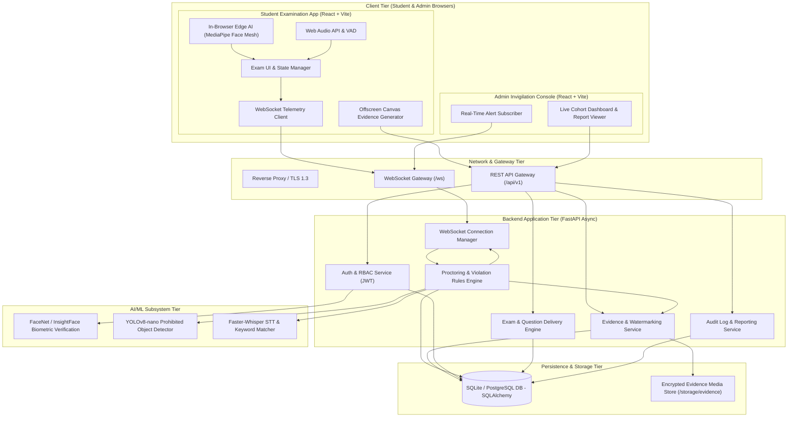
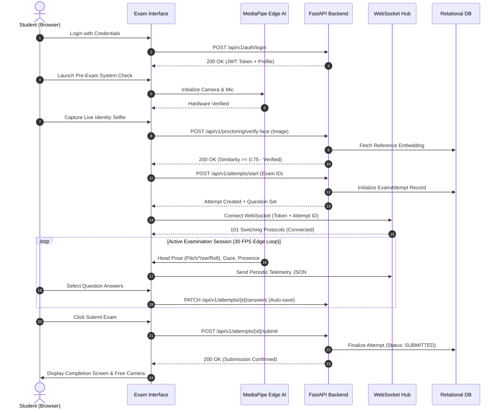
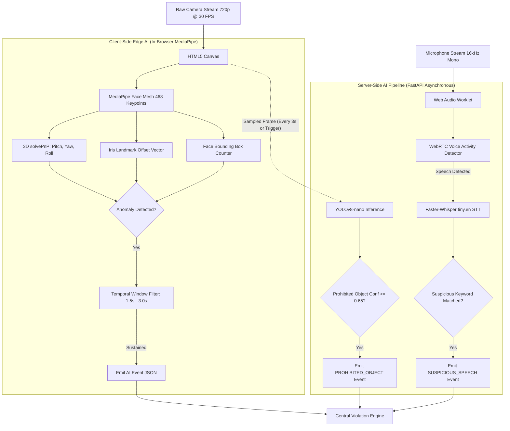
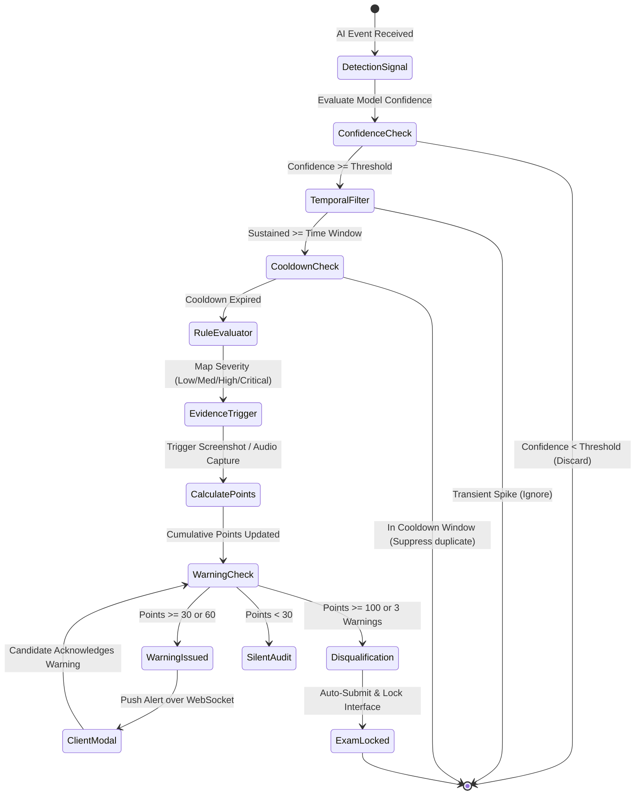
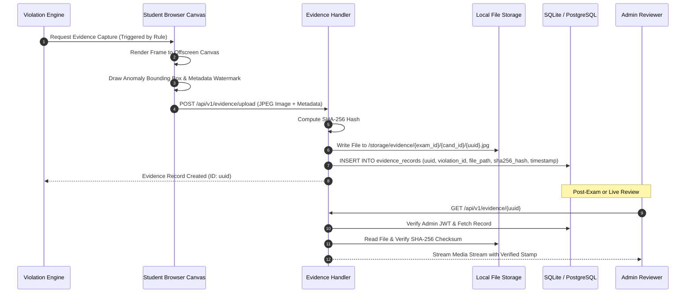
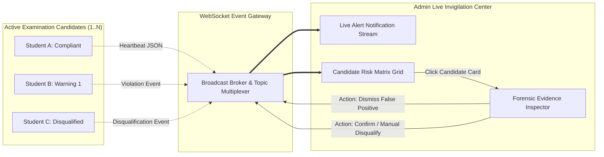

# 04 — System Architecture: AI-Powered Secure Online Examination & Proctoring System

This document outlines the end-to-end multi-tier architecture, data flows, subsystem boundaries, network communication protocols, and processing pipelines.

---

## 1. High-Level Architecture Overview

The system employs a **Hybrid Edge-Server Architecture**. High-frequency facial geometry tracking (468-point Face Mesh, 3D Head Pose, Eye Gaze, and Face Presence) is executed client-side directly in the candidate's browser via WebAssembly/WebGL to ensure zero network latency, zero video bandwidth saturation, and absolute privacy during normal operation. 

Server-side services handle heavy biometric embeddings (FaceNet / InsightFace for identity verification), sampled-frame deep learning object detection (YOLOv8-nano), speech-to-text processing (Faster-Whisper), relational transaction management, violation rule evaluation, and real-time WebSocket telemetry distribution to invigilators.

---

## 2. Mermaid Architecture Diagrams

### 2.1. System Architecture Diagram

---

### 2.2. Student Examination Flow

---

### 2.3. AI Proctoring Pipeline

---

### 2.4. Violation Lifecycle

---

### 2.5. Evidence Lifecycle

---

### 2.6. Admin Monitoring Flow

---

## 3. Subsystem Breakdown

### 3.1. Frontend Tier (React + Vite)
- **Framework**: React 18 / 19 using TypeScript for strict type guarantees across API and telemetry payloads.
- **Routing**: Client-side declarative routing (`react-router-dom`) with authenticated Route Guards separating Student and Admin workspaces.
- **UI & Design**: Tailwind CSS utility framework coupled with Lucide React iconography for responsive, lightweight, accessible UI styling.
- **State Management**: Zustand / React Context for lean, global, synchronous state tracking (exam questions, current selected answers, remaining timer seconds, real-time proctoring status).
- **Edge Vision Engine**: MediaPipe Face Mesh JavaScript/Wasm package executing on an unrendered HTML5 `<video>` element, mapping 468 landmark coordinates at 30 FPS.

### 3.2. Backend Application Tier (Python FastAPI)
- **Framework**: FastAPI running under Uvicorn with `asyncio` event loops for high-concurrency non-blocking I/O.
- **API Protocol**: RESTful JSON endpoints complying with OpenAPI 3.0 standards.
- **Real-Time Gateway**: WebSockets (`FastAPI.WebSocket`) handling persistent bidirectional channels with heartbeat pings and group broadcasts.
- **Data Validation**: Pydantic v2 schemas providing automatic data validation, error serialization, and typed request bodies.

### 3.3. Artificial Intelligence & Computer Vision Tier
- **Facial Landmark & Pose**: MediaPipe Face Mesh Wasm runtime (client) computing Euler angles via 3D keypoint Perspective-n-Point estimation.
- **Facial Verification**: Python `face_recognition` / `InsightFace` generating 128-dimensional L2-normalized feature vectors for cosine similarity distance checks.
- **Object Detection**: Ultralytics `YOLOv8-nano` PyTorch/ONNX model trained on COCO dataset, running on 640x640 resolution sampled frames.
- **Speech Intelligence**: `Faster-Whisper` running quantized `tiny.en` CTranslate2 models for low-latency acoustic transcription on standard CPU cores.

### 3.4. Persistence & Storage Tier
- **Relational Database**: SQLite with WAL (Write-Ahead Logging) mode enabled for zero-config hackathon execution, abstracted via SQLAlchemy 2.0 Async ORM (allowing seamless migration to PostgreSQL without code refactoring).
- **Evidence Storage**: Structured filesystem storage under `/storage/evidence/{exam_id}/{candidate_id}/` indexed by UUIDv4 with strict Unix permissions (0600) and SHA-256 verification.
