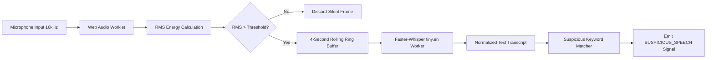

# 06 — AI/ML Architecture: Vision, Gaze, Object & Audio Subsystems

This document specifies the artificial intelligence and machine learning pipelines, landmark geometry mathematics, neural network models, inference schedules, feature extraction schemas, and error-mitigation strategies.

---

## 1. Core Architectural Principle: AI as Probabilistic Signals

> [!IMPORTANT]
> **Fundamental Principle**: AI detections are probabilistic signals, **never final judicial verdicts**. 
> Environmental variations (backlighting, glasses reflections, peripheral movement, innocuous throat clearing) produce transient false positives. The AI subsystem's sole responsibility is emitting structured, timestamped **AI Telemetry Events** with calibrated confidence scores. Decisions regarding warnings, penalties, or disqualifications are strictly quarantined within the downstream **Violation Engine** (Document 07).

---

## 2. Common AI Event Schema

All vision, gaze, object, and acoustic detectors emit events conforming to a strictly typed common JSON schema:

```typescript
interface AIEventPayload {
  eventId: string;             // UUIDv4 unique identifier
  candidateId: string;         // Student UUID
  examId: string;              // Exam UUID
  attemptId: string;           // Active Attempt UUID
  eventType: AIEventType;      // Enum of detector category
  confidence: number;          // Range [0.00, 1.00]
  timestamp: string;           // ISO 8601 UTC timestamp (e.g. 2026-09-11T05:15:30.124Z)
  durationMs: number;          // Continuous duration of anomalous state in milliseconds
  source: "CLIENT_EDGE" | "SERVER_WORKER";
  metadata: Record<string, any>; // Subsystem-specific telemetry payloads
}

type AIEventType = 
  | "FACE_ABSENT"
  | "MULTIPLE_FACES"
  | "IDENTITY_MISMATCH"
  | "HEAD_POSE_ANOMALY"
  | "LOOKING_AWAY"
  | "PROHIBITED_OBJECT"
  | "ADDITIONAL_PERSON"
  | "SUSPICIOUS_SPEECH"
  | "BACKGROUND_CONVERSATION"
  | "TAB_SWITCH_OR_BLUR";
```

---

## 3. Facial Analysis Subsystems (Client-Side Edge)

### 3.1. Face Presence & Multiple Face Detection
- **Model**: MediaPipe Face Mesh (`@mediapipe/tasks-vision`) running on HTML5 canvas via WebAssembly.
- **Inference Rate**: 15–30 FPS (adaptive based on client device capabilities).
- **Processing Logic**:
  1. Detect all face bounding boxes within the frame.
  2. Let $N$ be the count of detected faces:
     - If $N = 0$: Start absence accumulator timer $T_{\text{absent}}$. If $T_{\text{absent}} \ge 2000\text{ms}$, emit `FACE_ABSENT` with confidence equal to model detector certainty ($> 0.85$).
     - If $N = 1$: Reset $T_{\text{absent}}$ and multi-face timer. System remains in nominal state.
     - If $N \ge 2$: Start multi-face accumulator timer $T_{\text{multi}}$. If $T_{\text{multi}} \ge 1000\text{ms}$, emit `MULTIPLE_FACES` with metadata `{ faceCount: N, boundingBoxes: [...] }`.

### 3.2. Facial Biometric Verification (Identity Consistency)
- **Model**: InsightFace / FaceNet running on backend (and optionally periodic 60s background verification).
- **Metric**: Deep Cosine Similarity between live embedding $v_{\text{live}}$ and baseline registered embedding $v_{\text{reg}}$:
  $$\text{CosineSimilarity}(v_{\text{live}}, v_{\text{reg}}) = \frac{v_{\text{live}} \cdot v_{\text{reg}}}{\|v_{\text{live}}\| \|v_{\text{reg}}\|}$$
- **Evaluation Criteria**:
  - Score $\ge 0.75$: Verified candidate match.
  - Score $0.60 - 0.74$: Marginal alignment/lighting drop; request re-alignment.
  - Score $< 0.60$: Emit `IDENTITY_MISMATCH` signal with confidence $1.0 - \text{Score}$.

---

## 4. 3D Head Pose Estimation Subsystem

### 4.1. Perspective-n-Point (solvePnP) Mathematical Formulation
Head pose is computed using a 3D canonical human head model mapped against 6 specific 2D facial landmarks obtained from MediaPipe Face Mesh:

```
Landmark Index Mapping:
1. Nose Tip:           Landmark 1
2. Chin:               Landmark 199
3. Left Eye Outer:     Landmark 33
4. Right Eye Outer:    Landmark 263
5. Left Mouth Corner:  Landmark 61
6. Right Mouth Corner: Landmark 291
```

Using the camera intrinsic matrix $K$:
$$K = \begin{bmatrix} f_x & 0 & c_x \\ 0 & f_y & c_y \\ 0 & 0 & 1 \end{bmatrix}$$
where focal lengths $f_x \approx f_y \approx \text{frame width}$, and principal point $(c_x, c_y)$ is at frame center.

The Levenberg-Marquardt or POSIT algorithm calculates rotation matrix $R$ and translation vector $T$:
$$s \begin{bmatrix} u \\ v \\ 1 \end{bmatrix} = K \begin{bmatrix} R & T \end{bmatrix} \begin{bmatrix} X_w \\ Y_w \\ Z_w \\ 1 \end{bmatrix}$$

Extract Euler angles (Pitch $\theta_x$, Yaw $\theta_y$, Roll $\theta_z$) from rotation matrix $R$:
$$\theta_y = \arcsin(R_{13})$$
$$\theta_x = \arctan2(-R_{23}, R_{33})$$
$$\theta_z = \arctan2(-R_{12}, R_{11})$$

### 4.2. Pose Anomaly Thresholds & Temporal Smoothing
- **Nominal Safe Zone**:
  - Yaw: $-28^\circ \le \theta_y \le +28^\circ$ (Candidate facing monitor)
  - Pitch: $-22^\circ \le \theta_x \le +22^\circ$ (Candidate not tilted upward to ceiling or downward to lap)
  - Roll: $-25^\circ \le \theta_z \le +25^\circ$
- **Temporal Filter**:
  To eliminate noise from rapid head bobs or coughing, Euler angles are smoothed via an Exponential Moving Average (EMA) ($\alpha = 0.35$):
  $$\hat{\theta}_t = \alpha \theta_t + (1 - \alpha) \hat{\theta}_{t-1}$$
  An anomaly event `HEAD_POSE_ANOMALY` is emitted only when smoothed $|\hat{\theta}| > \text{Threshold}$ continuously for $\ge 2500\text{ms}$.

---

## 5. Eye Gaze Tracking Subsystem

### 5.1. Iris-to-Canthus Coordinate Ratio
Eye gaze is tracked independently of head pose to catch subtle glancing at notes beside the display while keeping the head stationary.

```
       [Inner Canthus]                      [Outer Canthus]
              +------------------------------------+
              |                 (Iris)             |
              |                   (o)              |
              +------------------------------------+
              |<------------- d_inner ------------>|
              |<----------------- D_eye ---------->|
```

1. Extract Iris center coordinates from MediaPipe Iris landmarks (Landmark 468 for Left Eye, Landmark 473 for Right Eye).
2. Measure Euclidean distance from Iris center to Inner Canthus ($d_{\text{inner}}$) and Outer Canthus ($d_{\text{outer}}$).
3. Compute Horizontal Gaze Ratio:
   $$\text{Ratio}_{\text{h}} = \frac{d_{\text{inner}}}{d_{\text{inner}} + d_{\text{outer}}}$$
4. Compute Vertical Gaze Ratio relative to Upper and Lower Eyelid landmarks.

### 5.2. Looking-Away Evaluation
- **Center Vision Range**: $0.38 \le \text{Ratio}_{\text{h}} \le 0.62$.
- **Deviation Categories**:
  - $\text{Ratio}_{\text{h}} < 0.35$: Sustained glance to the left.
  - $\text{Ratio}_{\text{h}} > 0.65$: Sustained glance to the right.
  - $\text{Ratio}_{\text{v}} > 0.70$: Sustained glance down toward lap/keyboard.
- **Persistence Criterion**: Deviation must persist for $\ge 3000\text{ms}$ to filter out natural rapid saccades (which last 50–200ms).

---

## 6. Prohibited Object Detection Subsystem

### 6.1. Neural Network Architecture & Model
- **Model**: Ultralytics YOLOv8-nano (`yolov8n.pt`, 3.2M parameters).
- **Input Dimension**: $640 \times 640$ pixels, RGB normalized.
- **Inference Pipeline**: Executed on sampled video frames (1 frame every 1.5 seconds, or on demand when triggered by rapid gaze/pose anomalies).

### 6.2. Target Classes & Filtering

| Target Class | COCO Class ID | MVP / Advanced | Minimum Confidence | Temporal Window |
| :--- | :--- | :--- | :--- | :--- |
| **Cell Phone** | 67 | **MVP** | 0.65 | 2 frames ($1.5\text{s} - 3.0\text{s}$) |
| **Laptop** | 63 | **MVP** | 0.70 | 2 frames ($1.5\text{s} - 3.0\text{s}$) |
| **Book / Binder** | 73 | **MVP** | 0.65 | 2 frames ($1.5\text{s} - 3.0\text{s}$) |
| **Headphones** | Custom heuristic | **MVP (Heuristic) / Adv** | 0.60 | 3 frames ($4.5\text{s}$) |
| **Calculator** | Custom / Fine-tune | **Advanced** | 0.70 | 2 frames ($3.0\text{s}$) |
| **Smartwatch** | Custom / Fine-tune | **Advanced** | 0.75 | 3 frames ($4.5\text{s}$) |

### 6.3. False-Positive Mitigation & Object Bounding Box Validation
- **Blacklist vs Whitelist Zones**: The candidate's own head region is excluded from phone/book detections to prevent confusing a hand resting on the cheek with a phone.
- **Persistence Verification**: Isolated single-frame detections ($<1.0\text{s}$) are logged as candidate anomalies in memory but **never** emitted as violations unless confirmed across a secondary consecutive frame.

---

## 7. Acoustic Intelligence & Speech Subsystem

### 7.1. Acoustic Pipeline Workflow



### 7.2. Speech-to-Text via Faster-Whisper
- **Engine**: Faster-Whisper using CTranslate2 with INT8 quantization (`tiny.en`, 39M parameters).
- **Execution**: Asynchronous execution inside a dedicated worker thread to prevent blocking FastAPI async event loops.
- **Latency**: Transcribes a 4-second audio chunk in $320\text{ms} - 550\text{ms}$ on modern 4-core CPUs.

### 7.3. Suspicious Keyword Registry & Matching Logic
The transcription string is lowercased, stripped of punctuation, and tokenized into n-grams. It is matched against three categorical lexicons:

1. **Direct Exam Questions**:
   `["what is the answer", "question number", "help me", "solve this", "option a", "option b", "option c", "option d", "true or false"]`
2. **Search Engine Queries**:
   `["google", "search for", "look up", "find the answer", "chat gpt", "wikipedia"]`
3. **Collaboration & Prompting**:
   `["tell me", "can you hear me", "repeat that", "what did you say", "read it out"]`

If any primary pattern matches with confidence $\ge 0.85$, a `SUSPICIOUS_SPEECH` signal is generated containing the verbatim transcript and matching keyword.

### 7.4. Background Conversation & Multi-Speaker Detection
- **MVP Approach**: Energy variation thresholding and intermittent speech bursts occurring when the candidate's mouth is static (MediaPipe Lip Distance $< 3\text{mm}$) indicates someone else is speaking in the room $\rightarrow$ triggers `BACKGROUND_CONVERSATION`.
- **Advanced Approach**: PyAnnote audio diarization clustering distinct speaker vocal embeddings.
