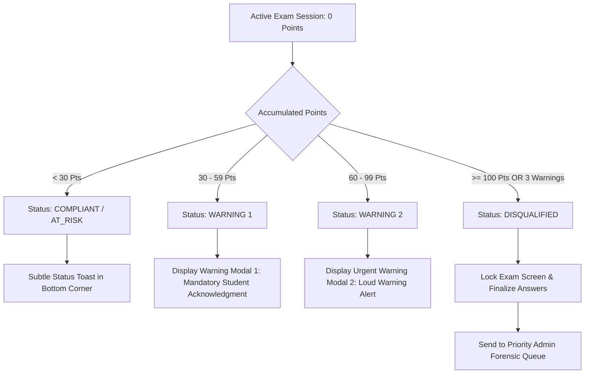

# 07 — Proctoring & Violation Engine: Taxonomy, Scoring & Escalation

This document defines the core decision intelligence of the proctoring platform. It governs the transformation of raw probabilistic AI telemetry into validated, equitable, and auditable academic integrity decisions.

---

## 1. Core Principles & Definitions

To prevent unfair penalties from sensor glitches, ambient noise, or natural bodily shifts, the system enforces a strict hierarchy of event progression:

```
+-------------------------------------------------------------------------------+
|                             DECISION HIERARCHY                                |
+-------------------------------------------------------------------------------+
  [1. Raw AI Detection]
      Direct output from a single frame/window (e.g. MediaPipe detects Yaw = 32°)
              |
              v
  [2. Suspicious Event (Candidate Anomaly)]
      A detection meeting minimum confidence (>= 0.65) that enters a temporal
      evaluation buffer for duration verification.
              |
              v
  [3. Confirmed Violation]
      A suspicious event whose duration exceeds the required persistence threshold
      outside of any active cooldown period. Recorded permanently in the database.
              |
              v
  [4. Strike Points & Warning Escalation]
      Points are accrued based on violation severity. Crossing point tiers triggers
      formal Warning 1, Warning 2, and student on-screen acknowledgment.
              |
              v
  [5. Automatic Disqualification]
      Triggered when cumulative points reach 100 OR after 3 unheeded warnings.
      The exam session is frozen and submitted for administrative review.
```

---

## 2. Violation Taxonomy & Specification Matrix

| Violation Code | Category | Severity Tier | Strike Points | Min Conf | Persistence Threshold | Cooldown Window | Required Evidence Type |
| :--- | :--- | :--- | :--- | :--- | :--- | :--- | :--- |
| `FACE_ABSENT` | Vision | MEDIUM | 25 | 0.85 | $\ge 2.0\text{ seconds}$ | 10 seconds | Screenshot (Empty Frame) |
| `MULTIPLE_FACES` | Vision | HIGH | 50 | 0.80 | $\ge 1.0\text{ second}$ | 12 seconds | Screenshot (Annotated Faces) |
| `IDENTITY_MISMATCH` | Biometric | CRITICAL | 100 | 0.75 | $\ge 1.0\text{ snapshot}$ | 0 seconds | Comparison Crop + Distance |
| `LOOKING_AWAY` | Gaze | LOW | 10 | 0.70 | $\ge 3.0\text{ seconds}$ | 8 seconds | Screenshot (Gaze Vectors) |
| `HEAD_POSE_ANOMALY` | Vision | LOW | 10 | 0.75 | $\ge 2.5\text{ seconds}$ | 8 seconds | Screenshot (Pose Wireframe) |
| `PROHIBITED_OBJECT` | Contraband | HIGH | 50 | 0.65 | $\ge 1.5\text{ seconds}$ (2 frames) | 15 seconds | Screenshot (Object Bounding Box) |
| `ADDITIONAL_PERSON` | Vision | HIGH | 50 | 0.70 | $\ge 1.5\text{ seconds}$ | 15 seconds | Screenshot (Person Bounding Box) |
| `SUSPICIOUS_SPEECH` | Acoustic | HIGH | 50 | 0.80 | $\ge 1.0\text{ utterance}$ | 10 seconds | 4-Sec Audio WAV + Transcript |
| `BACKGROUND_CONVERSATION` | Acoustic | MEDIUM | 25 | 0.70 | $\ge 2.0\text{ seconds}$ | 12 seconds | 4-Sec Audio WAV + Transcript |
| `TAB_SWITCH_OR_BLUR`| System | MEDIUM | 25 | 1.00 | Instant ($\ge 1\text{ blur event}$) | 5 seconds | System Event Log |

---

## 3. Detailed Parameter Explanations

### 3.1. Severity Tiers & Point Weights
- **LOW (10 Points)**: Minor, non-definitive behaviors (glancing away briefly, slight head tilt). Designed to nudge the student without causing immediate failure.
- **MEDIUM (25 Points)**: Moderate suspicious actions (leaving the desk, switching browser tabs, audible ambient voices). Indicates a clear breach of standard testing conduct.
- **HIGH (50 Points)**: Severe, active cheating indicators (holding a smartphone, secondary face leaning into view, uttering question keywords). Two high-severity events result in automatic disqualification.
- **CRITICAL (100 Points)**: Definitive surrogate test-taker or identity fraud. Results in immediate single-event disqualification.

### 3.2. Temporal Persistence Windows
Human beings naturally blink, swallow, adjust their chair, or scratch their nose. A detection must persist for a continuous window ($T_{\text{sustained}} \ge T_{\text{threshold}}$) before it transitions from an internal memory buffer to a confirmed violation.

```
Time Timeline (Seconds):
0.0s             1.0s             2.0s             2.5s             3.0s
|----------------|----------------|----------------|----------------|
Detect Yaw > 28°
[---------------- Candidate Anomaly Buffered ----------------]
                                                   ^
                                            Threshold Reached!
                                            Confirmed Violation Triggered!
```

If the candidate returns their head to center before $2.5\text{s}$, the buffer resets to zero with **zero penalty recorded**.

### 3.3. Cooldown Mechanism
When a student turns their head to look at a cheat sheet for 10 seconds, naive systems would trigger a violation every single second, issuing 10 violations for one continuous action. 

The **Cooldown Timer** prevents duplicate penalties: once a violation of a specific code is triggered, that detector enters a cooldown state for $N$ seconds (e.g., 8–15s). Subsequent anomalous detections during this window only extend the event duration log rather than adding redundant penalty strikes.

---

## 4. Configurable Scoring & Escalation Model

### 4.1. Mathematical Formulation of Candidate Trust Score
Every student begins with an **Integrity Trust Score** of $100\%$:
$$\text{TrustScore} = \max\left(0, 100 - \sum_{i=1}^{M} \text{Points}(V_i)\right)$$
where $V_i$ represents the $i$-th confirmed violation and $\text{Points}(V_i) \in \{10, 25, 50, 100\}$.

### 4.2. Warning Thresholds & Interventions



### 4.3. Warning Escalation Rules
1. **Strike Level 1 (At 30 Points)**:
   - System pauses question interaction with a semi-transparent modal.
   - Message: *"Warning 1 of 3: Suspicious activity (e.g. repeated looking away or tab switching) has been recorded. Please keep your eyes centered on the screen."*
   - Student must click **"I Understand & Agree"** to resume.
2. **Strike Level 2 (At 60 Points)**:
   - High-contrast yellow/red banner locked across the top of the interface.
   - Message: *"URGENT WARNING 2 of 3: High-severity violation recorded. Further violations will cause immediate disqualification."*
   - Admin dashboard receives an immediate priority alert beep.
3. **Disqualification (At 100 Points or 3rd Warning)**:
   - Interface is permanently locked.
   - Message: *"Examination Terminated: You have been disqualified due to repeated violations of academic integrity. Your responses up to this point have been archived for administrative review."*
   - Active media streams are stopped; session state changes to `DISQUALIFIED`.

---

## 5. Violation Engine Algorithm (Pseudocode)

```python
class ViolationEngine:
    def __init__(self, candidate_id: str, exam_id: str, rules_config: Dict):
        self.candidate_id = candidate_id
        self.exam_id = exam_id
        self.config = rules_config
        self.cumulative_points = 0
        self.warning_count = 0
        self.anomaly_buffers: Dict[str, float] = {}
        self.cooldown_timers: Dict[str, float] = {}

    def process_ai_event(self, event: AIEventPayload) -> Optional[ViolationRecord]:
        rule = self.config.get_rule(event.event_type)
        current_time = time.time()

        # Step 1: Confidence Check
        if event.confidence < rule.min_confidence:
            return None

        # Step 2: Check Cooldown
        if current_time < self.cooldown_timers.get(event.event_type, 0):
            return None

        # Step 3: Check Temporal Persistence
        if event.duration_ms < rule.persistence_ms:
            # Buffer anomaly timestamp
            self.anomaly_buffers[event.event_type] = current_time
            return None

        # Step 4: Confirm Violation
        violation = ViolationRecord(
            id=uuid4(),
            candidate_id=self.candidate_id,
            exam_id=self.exam_id,
            violation_code=event.event_type,
            severity=rule.severity,
            points=rule.points,
            timestamp=datetime.utcnow(),
            duration_seconds=event.duration_ms / 1000.0,
            confidence_score=event.confidence
        )

        # Step 5: Update State & Points
        self.cumulative_points += rule.points
        self.cooldown_timers[event.event_type] = current_time + rule.cooldown_seconds
        self.anomaly_buffers.pop(event.event_type, None)

        # Step 6: Evaluate Escalation
        if self.cumulative_points >= 100 or self.warning_count >= 3:
            violation.escalation_action = "DISQUALIFY"
        elif self.cumulative_points >= 60 and self.warning_count < 2:
            self.warning_count = 2
            violation.escalation_action = "ISSUE_WARNING_2"
        elif self.cumulative_points >= 30 and self.warning_count < 1:
            self.warning_count = 1
            violation.escalation_action = "ISSUE_WARNING_1"

        return violation
```

---

## 6. False-Positive Mitigation & Human Review Safeguards

1. **Context-Aware Exemptions**:
   - Natural question transitions (first 3 seconds after clicking "Next Question") allow relaxed gaze angles to accommodate scrolling.
   - Screen resolution calibration ensures students on ultra-wide monitors do not get penalized for reading text positioned in the corners.
2. **Administrative Override Authority**:
   - Disqualified candidates are placed in an **Administrative Audit Queue**.
   - An invigilator can review the synchronized evidence (Document 08). If a student was looking down because of an unavoidable fit of coughing, the admin clicks **[Dismiss Violation]**, which rolls back the strike points and restores the student's status.
