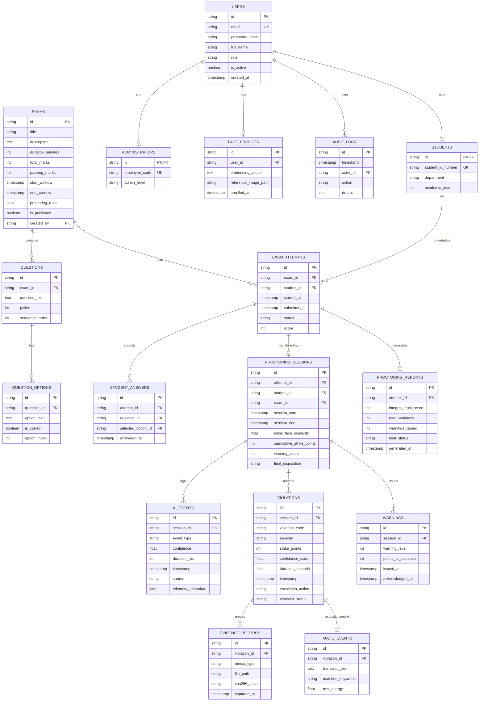

# 09 — Database Design: Schema, Entities, Indexes & ER Diagram

This document defines the relational database architecture supporting the proctoring platform, specified for SQLite (hackathon default) and fully portable to PostgreSQL via SQLAlchemy 2.0.

---

## 1. Entity-Relationship (ER) Diagram

---

## 2. Table Specifications & Data Dictionaries

### 2.1. `users`
Core identity table storing base account credentials for all roles.
- **Fields**:
  - `id`: `VARCHAR(36)` | **PRIMARY KEY** (UUIDv4)
  - `email`: `VARCHAR(255)` | **UNIQUE, NOT NULL**
  - `password_hash`: `VARCHAR(255)` | **NOT NULL**
  - `full_name`: `VARCHAR(150)` | **NOT NULL**
  - `role`: `VARCHAR(20)` | **NOT NULL** (Enum: `'student'`, `'admin'`, `'super_admin'`)
  - `is_active`: `BOOLEAN` | **DEFAULT TRUE, NOT NULL**
  - `created_at`: `TIMESTAMP` | **DEFAULT CURRENT_TIMESTAMP, NOT NULL**
- **Indexes**: `idx_users_email (email)`, `idx_users_role (role)`

### 2.2. `students`
Specialized table extending `users` with institutional student metadata.
- **Fields**:
  - `id`: `VARCHAR(36)` | **PRIMARY KEY, FOREIGN KEY** references `users(id)` ON DELETE CASCADE
  - `student_id_number`: `VARCHAR(50)` | **UNIQUE, NOT NULL** (e.g. "CS2026049")
  - `department`: `VARCHAR(100)` | **NOT NULL**
  - `academic_year`: `INTEGER` | **NOT NULL**

### 2.3. `administrators`
Specialized table extending `users` with invigilation staff credentials.
- **Fields**:
  - `id`: `VARCHAR(36)` | **PRIMARY KEY, FOREIGN KEY** references `users(id)` ON DELETE CASCADE
  - `employee_code`: `VARCHAR(50)` | **UNIQUE, NOT NULL**
  - `admin_level`: `VARCHAR(30)` | **DEFAULT 'invigilator', NOT NULL**

### 2.4. `face_profiles`
Stores reference biometric data for pre-exam face verification.
- **Fields**:
  - `id`: `VARCHAR(36)` | **PRIMARY KEY** (UUIDv4)
  - `user_id`: `VARCHAR(36)` | **FOREIGN KEY** references `users(id)` ON DELETE CASCADE
  - `embedding_vector`: `TEXT` | **NOT NULL** (JSON string of 128 or 512 float values)
  - `reference_image_path`: `VARCHAR(500)` | **NOT NULL**
  - `enrolled_at`: `TIMESTAMP` | **DEFAULT CURRENT_TIMESTAMP, NOT NULL**
- **Indexes**: `idx_face_profiles_user_id (user_id)`

### 2.5. `exams`
Examination configurations, time windows, and proctoring parameters.
- **Fields**:
  - `id`: `VARCHAR(36)` | **PRIMARY KEY** (UUIDv4)
  - `title`: `VARCHAR(200)` | **NOT NULL**
  - `description`: `TEXT`
  - `duration_minutes`: `INTEGER` | **NOT NULL** (e.g. 60)
  - `total_marks`: `INTEGER` | **NOT NULL** (e.g. 100)
  - `passing_marks`: `INTEGER` | **NOT NULL** (e.g. 40)
  - `start_window`: `TIMESTAMP` | **NOT NULL**
  - `end_window`: `TIMESTAMP` | **NOT NULL**
  - `proctoring_rules`: `JSON` | **NOT NULL** (Configurable thresholds: gaze, pose, points)
  - `is_published`: `BOOLEAN` | **DEFAULT FALSE, NOT NULL**
  - `created_by`: `VARCHAR(36)` | **FOREIGN KEY** references `administrators(id)`
- **Indexes**: `idx_exams_window (start_window, end_window)`

### 2.6. `questions` & `question_options`
Question pool and individual multiple-choice response options.
- **`questions` Fields**:
  - `id`: `VARCHAR(36)` | **PRIMARY KEY**
  - `exam_id`: `VARCHAR(36)` | **FOREIGN KEY** references `exams(id)` ON DELETE CASCADE
  - `question_text`: `TEXT` | **NOT NULL**
  - `points`: `INTEGER` | **DEFAULT 1, NOT NULL**
  - `sequence_order`: `INTEGER` | **NOT NULL**
- **`question_options` Fields**:
  - `id`: `VARCHAR(36)` | **PRIMARY KEY**
  - `question_id`: `VARCHAR(36)` | **FOREIGN KEY** references `questions(id)` ON DELETE CASCADE
  - `option_text`: `TEXT` | **NOT NULL**
  - `is_correct`: `BOOLEAN` | **DEFAULT FALSE, NOT NULL**
  - `option_index`: `INTEGER` | **NOT NULL** (0 = A, 1 = B, 2 = C, 3 = D)

### 2.7. `exam_attempts` & `student_answers`
Tracks individual student exam sessions and auto-saved answers.
- **`exam_attempts` Fields**:
  - `id`: `VARCHAR(36)` | **PRIMARY KEY**
  - `exam_id`: `VARCHAR(36)` | **FOREIGN KEY** references `exams(id)`
  - `student_id`: `VARCHAR(36)` | **FOREIGN KEY** references `students(id)`
  - `started_at`: `TIMESTAMP` | **DEFAULT CURRENT_TIMESTAMP, NOT NULL**
  - `submitted_at`: `TIMESTAMP` | **NULLABLE**
  - `status`: `VARCHAR(25)` | **NOT NULL** (Enum: `'IN_PROGRESS'`, `'SUBMITTED'`, `'DISQUALIFIED'`)
  - `score`: `INTEGER` | **DEFAULT 0**
- **Constraints**: `UNIQUE (exam_id, student_id)` (One attempt per student per exam)

- **`student_answers` Fields**:
  - `id`: `VARCHAR(36)` | **PRIMARY KEY**
  - `attempt_id`: `VARCHAR(36)` | **FOREIGN KEY** references `exam_attempts(id)` ON DELETE CASCADE
  - `question_id`: `VARCHAR(36)` | **FOREIGN KEY** references `questions(id)`
  - `selected_option_id`: `VARCHAR(36)` | **FOREIGN KEY** references `question_options(id)`
  - `answered_at`: `TIMESTAMP` | **DEFAULT CURRENT_TIMESTAMP, NOT NULL**
- **Constraints**: `UNIQUE (attempt_id, question_id)` (Enforces UPSERT semantics on answer updates)

### 2.8. `proctoring_sessions`
High-level session tracking the integrity state of an exam attempt.
- **Fields**:
  - `id`: `VARCHAR(36)` | **PRIMARY KEY**
  - `attempt_id`: `VARCHAR(36)` | **UNIQUE, FOREIGN KEY** references `exam_attempts(id)` ON DELETE CASCADE
  - `student_id`: `VARCHAR(36)` | **FOREIGN KEY** references `students(id)`
  - `exam_id`: `VARCHAR(36)` | **FOREIGN KEY** references `exams(id)`
  - `session_start`: `TIMESTAMP` | **DEFAULT CURRENT_TIMESTAMP, NOT NULL**
  - `session_end`: `TIMESTAMP` | **NULLABLE**
  - `initial_face_similarity`: `FLOAT` | **NOT NULL**
  - `cumulative_strike_points`: `INTEGER` | **DEFAULT 0, NOT NULL**
  - `warning_count`: `INTEGER` | **DEFAULT 0, NOT NULL**
  - `final_disposition`: `VARCHAR(30)` | **DEFAULT 'COMPLIANT', NOT NULL** (Enum: `'COMPLIANT'`, `'WARNING_1'`, `'WARNING_2'`, `'DISQUALIFIED'`)

### 2.9. `ai_events`
High-frequency telemetry stream logged for analytical auditing.
- **Fields**:
  - `id`: `VARCHAR(36)` | **PRIMARY KEY**
  - `session_id`: `VARCHAR(36)` | **FOREIGN KEY** references `proctoring_sessions(id)` ON DELETE CASCADE
  - `event_type`: `VARCHAR(50)` | **NOT NULL**
  - `confidence`: `FLOAT` | **NOT NULL**
  - `duration_ms`: `INTEGER` | **NOT NULL**
  - `timestamp`: `TIMESTAMP` | **NOT NULL**
  - `source`: `VARCHAR(20)` | **NOT NULL**
  - `telemetry_metadata`: `JSON`
- **Indexes**: `idx_ai_events_session (session_id, timestamp)`

### 2.10. `violations`
Confirmed, actionable violations created by the Violation Engine.
- **Fields**:
  - `id`: `VARCHAR(36)` | **PRIMARY KEY**
  - `session_id`: `VARCHAR(36)` | **FOREIGN KEY** references `proctoring_sessions(id)` ON DELETE CASCADE
  - `violation_code`: `VARCHAR(50)` | **NOT NULL**
  - `severity`: `VARCHAR(20)` | **NOT NULL** (Enum: `'LOW'`, `'MEDIUM'`, `'HIGH'`, `'CRITICAL'`)
  - `strike_points`: `INTEGER` | **NOT NULL**
  - `confidence_score`: `FLOAT` | **NOT NULL**
  - `duration_seconds`: `FLOAT` | **NOT NULL**
  - `timestamp`: `TIMESTAMP` | **NOT NULL**
  - `escalation_action`: `VARCHAR(30)` | **DEFAULT 'NONE'`
  - `reviewer_status`: `VARCHAR(25)` | **DEFAULT 'PENDING'** (Enum: `'PENDING'`, `'CONFIRMED'`, `'DISMISSED'`)
- **Indexes**: `idx_violations_session (session_id)`

### 2.11. `warnings`
Records official warning overlays delivered to the student screen.
- **Fields**:
  - `id`: `VARCHAR(36)` | **PRIMARY KEY**
  - `session_id`: `VARCHAR(36)` | **FOREIGN KEY** references `proctoring_sessions(id)` ON DELETE CASCADE
  - `warning_level`: `INTEGER` | **NOT NULL** (1 or 2)
  - `points_at_issuance`: `INTEGER` | **NOT NULL**
  - `issued_at`: `TIMESTAMP` | **DEFAULT CURRENT_TIMESTAMP, NOT NULL**
  - `acknowledged_at`: `TIMESTAMP` | **NULLABLE**

### 2.12. `evidence_records`
Permanent file references, hashes, and metadata for screenshots and audio clips.
- **Fields**:
  - `id`: `VARCHAR(36)` | **PRIMARY KEY**
  - `violation_id`: `VARCHAR(36)` | **FOREIGN KEY** references `violations(id)` ON DELETE CASCADE
  - `media_type`: `VARCHAR(20)` | **NOT NULL** (Enum: `'IMAGE_JPEG'`, `'AUDIO_WAV'`)
  - `file_path`: `VARCHAR(500)` | **NOT NULL**
  - `sha256_hash`: `VARCHAR(64)` | **NOT NULL**
  - `captured_at`: `TIMESTAMP` | **NOT NULL**
- **Indexes**: `idx_evidence_violation (violation_id)`

### 2.13. `audio_events`
Specialized acoustic metadata attached to speech violations.
- **Fields**:
  - `id`: `VARCHAR(36)` | **PRIMARY KEY**
  - `violation_id`: `VARCHAR(36)` | **FOREIGN KEY** references `violations(id)` ON DELETE CASCADE
  - `transcript_text`: `TEXT` | **NOT NULL**
  - `matched_keywords`: `VARCHAR(255)` | **NOT NULL**
  - `rms_energy`: `FLOAT` | **NOT NULL**

### 2.14. `proctoring_reports`
Final summary scorecard generated upon attempt completion.
- **Fields**:
  - `id`: `VARCHAR(36)` | **PRIMARY KEY**
  - `attempt_id`: `VARCHAR(36)` | **UNIQUE, FOREIGN KEY** references `exam_attempts(id)` ON DELETE CASCADE
  - `integrity_trust_score`: `INTEGER` | **NOT NULL** (0 to 100)
  - `total_violations`: `INTEGER` | **NOT NULL**
  - `warnings_issued`: `INTEGER` | **NOT NULL**
  - `final_status`: `VARCHAR(30)` | **NOT NULL**
  - `generated_at`: `TIMESTAMP` | **DEFAULT CURRENT_TIMESTAMP, NOT NULL**

### 2.15. `audit_logs`
Tamper-evident system activity log.
- **Fields**:
  - `id`: `VARCHAR(36)` | **PRIMARY KEY**
  - `timestamp`: `TIMESTAMP` | **DEFAULT CURRENT_TIMESTAMP, NOT NULL**
  - `actor_id`: `VARCHAR(36)` | **NOT NULL**
  - `action`: `VARCHAR(50)` | **NOT NULL**
  - `details`: `JSON` | **NOT NULL**
- **Indexes**: `idx_audit_actor (actor_id)`, `idx_audit_action (action)`
