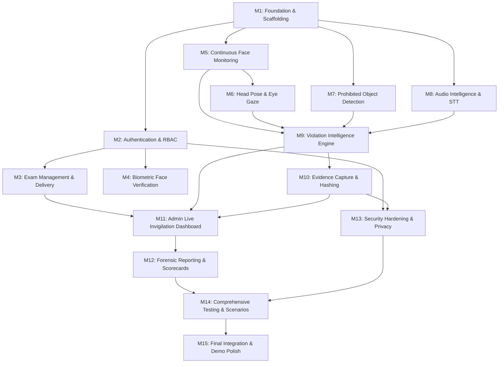

# 16 — Development Roadmap: Milestones M1 through M15

This document outlines the sequential, dependency-ordered engineering roadmap for the proctoring platform. Each milestone represents an independently testable increment.

---

## Milestone Dependency Graph

---

## Detailed Milestone Specifications

### M1: Foundation & Project Scaffolding
- **Objective**: Establish frontend and backend environments, linting, formatting, shared types, and build scripts.
- **Features**: Vite + React + Tailwind setup, FastAPI application skeleton, Uvicorn runner, CORS middleware, async SQLite connection.
- **Expected Files**: `frontend/vite.config.ts`, `frontend/package.json`, `backend/app/main.py`, `backend/app/db/session.py`.
- **Dependencies**: None.
- **Acceptance Criteria**: Both servers start concurrently without errors; frontend renders starter page; backend serves OpenAPI `/docs`.
- **Risks**: Node / Python version incompatibilities.

---

### M2: Authentication & User Profiles
- **Objective**: Implement student and admin accounts, password security, and JWT sessions.
- **Features**: User registration, login endpoint, password hashing via `bcrypt`, role-based access control (RBAC), protected route wrappers in React.
- **Expected Files**: `backend/app/api/v1/endpoints/auth.py`, `backend/app/core/security.py`, `frontend/src/store/useAuthStore.ts`.
- **Dependencies**: M1.
- **Acceptance Criteria**: Student and Admin can log in; invalid passwords rejected with 401; protected pages redirect unauthenticated users.
- **Risks**: Token expiration handling during active exams.

---

### M3: Examination Management & Question Delivery
- **Objective**: Build exam authoring for admins and question-taking workspace for candidates.
- **Features**: Exam CRUD, question authoring with 4 MCQ choices, student question palette, countdown timer, auto-save on option click.
- **Expected Files**: `backend/app/services/exam_service.py`, `frontend/src/pages/student/ActiveExamPage.tsx`, `frontend/src/store/useExamStore.ts`.
- **Dependencies**: M2.
- **Acceptance Criteria**: Admin can create an exam; student can start an attempt, select answers, see timer countdown, and submit.
- **Risks**: Network drop losing student answer state (mitigated by optimistic local storage).

---

### M4: Biometric Face Verification
- **Objective**: Implement initial identity onboarding and pre-exam face verification.
- **Features**: Profile photo upload, facial feature extraction via InsightFace/face_recognition, live webcam capture, cosine similarity comparison.
- **Expected Files**: `backend/app/ai_workers/face_verifier.py`, `frontend/src/pages/student/FaceVerificationPage.tsx`.
- **Dependencies**: M2.
- **Acceptance Criteria**: Matching face passes with similarity $\ge 0.75$; different face or empty frame is blocked.
- **Risks**: Poor lighting causing false negative rejections during verification.

---

### M5: Continuous Vision Monitoring (Presence & Count)
- **Objective**: Implement real-time client-side face tracking.
- **Features**: MediaPipe Face Mesh integration in React, face presence counter, absence detection ($>2.0\text{s}$), multi-face detection ($>1.0\text{s}$).
- **Expected Files**: `frontend/src/hooks/useMediaPipe.ts`, `frontend/src/components/proctoring/WebcamMonitor.tsx`.
- **Dependencies**: M1.
- **Acceptance Criteria**: Walking away from camera triggers absence within 2.5s; second person leaning in triggers multi-face warning.
- **Risks**: High CPU usage on older laptops (mitigated by throttling inference to 15–20 FPS).

---

### M6: 3D Head Pose & Eye Gaze Tracking
- **Objective**: Detect non-centered head orientations and looking-away behaviors.
- **Features**: 3D solvePnP algorithm extracting Euler angles (Pitch, Yaw, Roll), Iris landmark offset calculation, temporal EMA smoothing.
- **Expected Files**: `frontend/src/utils/headPoseMath.ts`, `frontend/src/utils/gazeMath.ts`.
- **Dependencies**: M5.
- **Acceptance Criteria**: Looking sideways at cheat sheet for $>2.5\text{s}$ generates `HEAD_POSE_ANOMALY`; glancing down for $>3.0\text{s}$ triggers `LOOKING_AWAY`.
- **Risks**: Glasses reflections disrupting iris detection.

---

### M7: Prohibited Object Detection
- **Objective**: Identify smartphones, laptops, and books in camera frame.
- **Features**: Server-side YOLOv8-nano inference on sampled frames, class filtering (`cell phone`, `book`, `laptop`), bounding box extraction.
- **Expected Files**: `backend/app/ai_workers/yolo_detector.py`, `backend/app/services/proctoring_service.py`.
- **Dependencies**: M1.
- **Acceptance Criteria**: Raising a mobile phone in front of webcam flags contraband within 2 frames with confidence $>0.65$.
- **Risks**: Occlusion or rapid movement causing intermittent frame drops.

---

### M8: Audio Intelligence & Keyword Spotting
- **Objective**: Monitor acoustic environment and transcribe suspicious questions.
- **Features**: Web Audio API RMS energy meter, Voice Activity Detection, Faster-Whisper local speech-to-text, suspicious keyword matching.
- **Expected Files**: `backend/app/ai_workers/whisper_transcriber.py`, `frontend/src/hooks/useAudioMonitor.ts`.
- **Dependencies**: M1.
- **Acceptance Criteria**: Speaking "What is the answer for question 3" generates transcript and flags `SUSPICIOUS_SPEECH`.
- **Risks**: Background fan noise triggering false VAD activations.

---

### M9: Violation Intelligence Engine
- **Objective**: Centralize decision logic, temporal filters, and escalation rules.
- **Features**: 8-stage verification pipeline, strike points (10/25/50/100), cooldown timers, warning modal delivery, automatic disqualification at 100 points or 3 warnings.
- **Expected Files**: `backend/app/services/violation_engine.py`, `frontend/src/components/proctoring/WarningModal.tsx`.
- **Dependencies**: M5, M6, M7, M8.
- **Acceptance Criteria**: Transient anomalies suppressed; sustained violations issue Warning 1, Warning 2, and clean Disqualification.
- **Risks**: Overlapping concurrent violations double-counting strikes (prevented by mutex cooldowns).

---

### M10: Evidence Capture & Cryptographic Hashing
- **Objective**: Capture watermarked screenshots and audio snippets for every confirmed violation.
- **Features**: Off-screen canvas watermark renderer, SHA-256 hash generation, filesystem partitioning, database linking.
- **Expected Files**: `backend/app/services/evidence_service.py`, `frontend/src/utils/watermark.ts`.
- **Dependencies**: M9.
- **Acceptance Criteria**: Screenshot saved with indelible header; SHA-256 hash matches file on disk; file linked to violation record.
- **Risks**: Storage disk exhaustion during long exams.

---

### M11: Administrator Live Invigilation Console
- **Objective**: Build a real-time command center for exam supervisors.
- **Features**: WebSocket live roster grid, candidate status badges, priority alert stream, evidence inspector modal with media player.
- **Expected Files**: `frontend/src/pages/admin/LiveMonitoringPage.tsx`, `backend/app/websocket/connection_manager.py`.
- **Dependencies**: M3, M9, M10.
- **Acceptance Criteria**: Admin observes student violation alerts in real time with $<1.0\text{s}$ latency; can inspect watermarked evidence.
- **Risks**: WebSocket disconnects under poor network conditions (handled via heartbeat auto-reconnect).

---

### M12: Forensic Reporting & Integrity Scorecards
- **Objective**: Generate auditable post-exam reports and candidate trust scorecards.
- **Features**: Calculation of Integrity Trust Score, chronological incident timeline, printable web layout / PDF export.
- **Expected Files**: `backend/app/services/report_service.py`, `frontend/src/pages/admin/ReportViewerPage.tsx`.
- **Dependencies**: M11.
- **Acceptance Criteria**: One-click generation of candidate report displaying scores, violation charts, and evidence thumbnails.
- **Risks**: Complex formatting during PDF export (mitigated by clean CSS `@media print` rules).

---

### M13: Security Hardening & Privacy Safeguards
- **Objective**: Protect candidate privacy and secure evidence assets against tampering.
- **Features**: Ephemeral signed media URLs, strict RBAC guards, encrypted embeddings, data minimization rules, student consent pre-flight.
- **Expected Files**: `backend/app/core/security.py`, `backend/app/api/deps.py`.
- **Dependencies**: M2, M10.
- **Acceptance Criteria**: Unauthenticated users cannot view evidence files; raw video is never permanently stored.
- **Risks**: Misconfigured CORS or token leakage.

---

### M14: Comprehensive Verification & Scenario Testing
- **Objective**: Validate the platform against all 20 predefined proctoring scenarios.
- **Features**: Automated unit tests (Vitest/Pytest), simulated student runs, edge-case recovery testing.
- **Expected Files**: `backend/tests/test_violation_engine.py`, `frontend/tests/headPose.test.ts`.
- **Dependencies**: M12, M13.
- **Acceptance Criteria**: All 20 scenarios pass without regressions; zero unexpected application crashes.
- **Risks**: Non-deterministic model results in continuous integration.

---

### M15: Final Integration & Demo Polish
- **Objective**: Rehearse end-to-end hackathon demonstration and finalize presentation scripts.
- **Features**: Pre-seeded demo exam with rich questions, deterministic violation triggers, polished UI animations, and README documentation.
- **Expected Files**: `backend/app/db/seed.py`, `docs/18-demo-plan.md`.
- **Dependencies**: M14.
- **Acceptance Criteria**: Complete 7-minute live demonstration executes flawlessly without technical hitches.
- **Risks**: Live webcam failure on demo day (mitigated by pre-recorded synthetic video fallback option).
