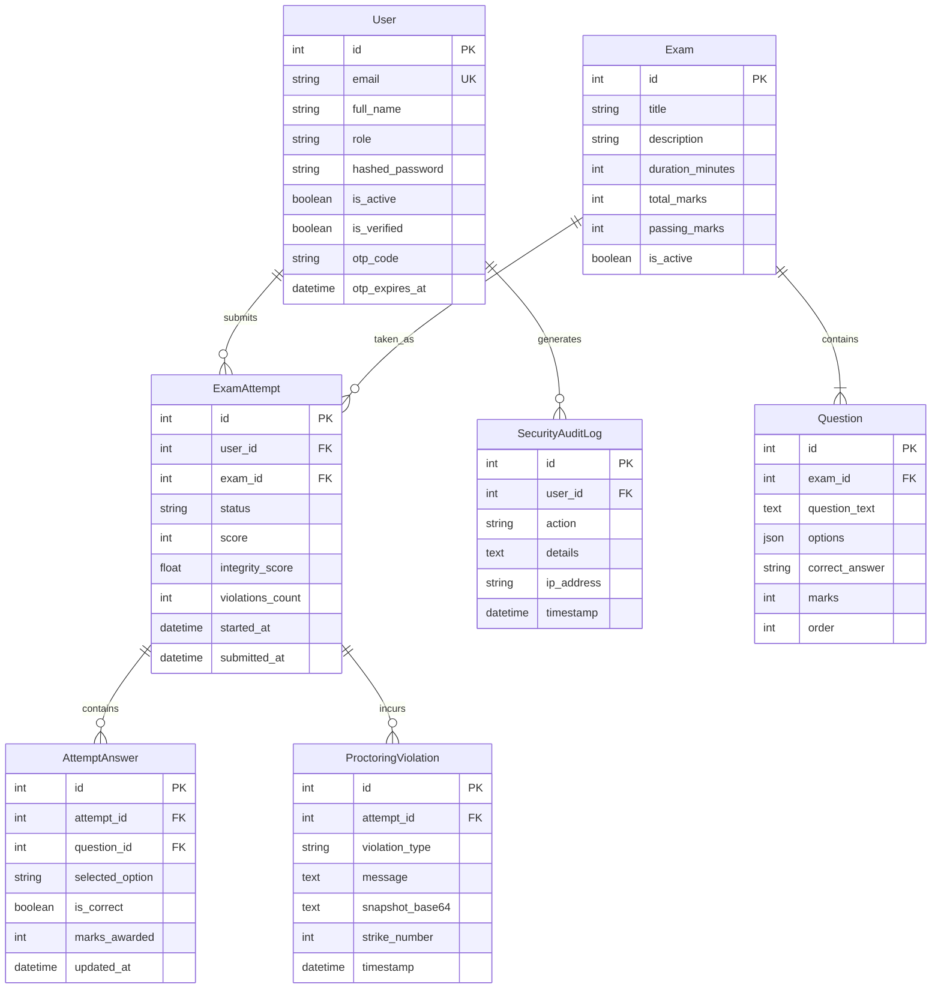

# ExamGuard AI — Database Architecture & Schema Specification

## 1. Database Overview
ExamGuard AI utilizes a normalized relational database schema powered by **SQLite** (`onlineexam.db`), mediated by **SQLAlchemy 2.0 ORM**. All operational records—including user identities, exam configurations, question banks, candidate answers, proctoring violations, and security audit logs—are persisted with foreign key constraints.

## 2. Entity Relationship Diagram

## 3. Table Schemas & Constraints

### 3.1 `exam_attempts`
| Column | Type | Constraints | Description |
|---|---|---|---|
| `id` | INTEGER | PRIMARY KEY, AUTOINCREMENT | Attempt identifier |
| `user_id` | INTEGER | FOREIGN KEY (`users.id`), NOT NULL | Candidate taking exam |
| `exam_id` | INTEGER | FOREIGN KEY (`exams.id`), NOT NULL | Associated examination |
| `status` | VARCHAR(20) | NOT NULL, DEFAULT "in_progress" | `"in_progress"`, `"submitted"`, `"terminated"` |
| `score` | INTEGER | DEFAULT 0 | Points earned |
| `integrity_score` | FLOAT | DEFAULT 100.0 | Calculated score: $\max(0, 100 - \text{strikes} \times 20)$ |
| `violations_count` | INTEGER | DEFAULT 0 | Count of active infractions |
| `answers_json` | TEXT | NULLABLE | JSON mirror for fast denormalized lookups |
| `started_at` | DATETIME | DEFAULT utcnow | Exam session start |
| `submitted_at` | DATETIME | NULLABLE | Completion or termination timestamp |

### 3.2 `attempt_answers`
- Fully normalized answer tracking per question per attempt.
- `UNIQUE(attempt_id, question_id)` upsert semantics ensure atomic autosave without duplicate rows.

### 3.3 `proctoring_violations`
- Stores timestamped infractions with the incident strike number, violation code (`MULTIPLE_FACES`, `NO_FACE`, `PHONE_DETECTED`, `TAB_SWITCH`, `FULLSCREEN_EXIT`), explanatory reason, and snapshot evidence.

### 3.4 `security_audit_logs`
- Append-only security journal recording actions such as `USER_LOGIN`, `EXAM_START`, `ANSWER_SAVE`, `VIOLATION_RECORDED`, and `EXAM_SUBMISSION` along with remote candidate IP addresses.
