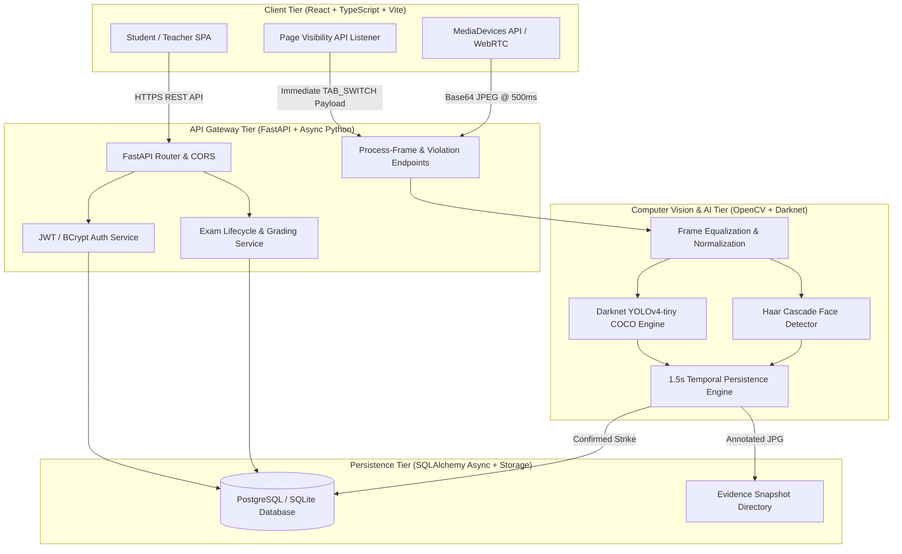
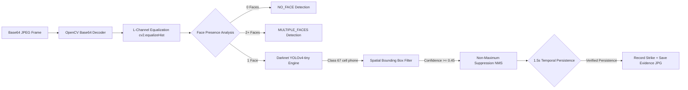
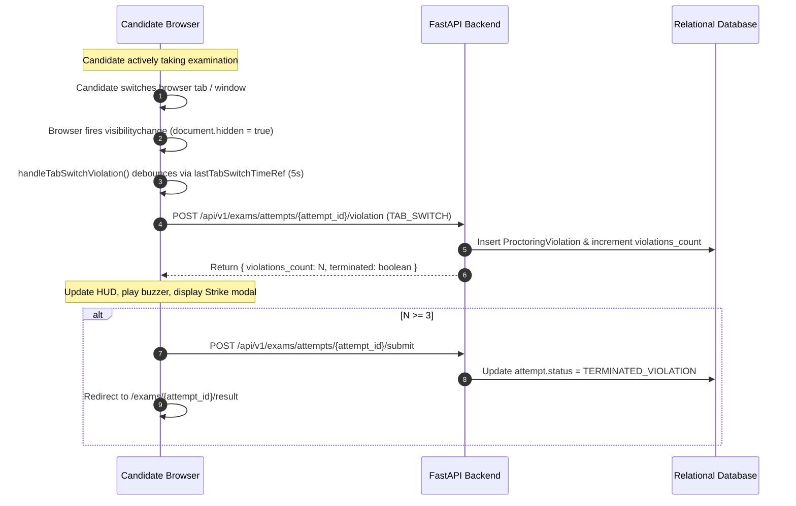

# Comprehensive System Architecture & Engineering Specifications

**Project Title**: AI-Powered Secure Online Examination & Proctoring System  
**System Class**: Production-Grade Full-Stack AI Proctoring Platform  
**Target Deployment**: Distributed Web Architecture  

---

## 1. High-Level Architectural Topology

The application utilizes a decoupled, three-tier architecture comprising a modern Single-Page Application (SPA) client, an asynchronous RESTful API gateway, an embedded Computer Vision Engine, and an Async Relational Database tier.

---

## 2. Layer-by-Layer Technical Architecture

### 2.1 Presentation & Client Tier (`frontend/`)
- **Technology Stack**: React 18, TypeScript 5, Vite 8, Tailwind CSS 3, Zustand 4.
- **Client Responsibilities**:
  - Renders responsive candidate and invigilator dashboards.
  - Manages WebRTC webcam media streams (`navigator.mediaDevices.getUserMedia`).
  - Samples frame snapshots onto offscreen HTML5 `<canvas>` elements at 500ms intervals.
  - Intercepts system events (Page Visibility API, prohibited hotkeys, right-click, window blur).
  - Handles client-side state via Zustand (`useAuthStore`) with local storage token sync.

---

### 2.2 API & Business Logic Tier (`backend/app/api/`)
- **Technology Stack**: FastAPI, Uvicorn, Python 3.14, PyJWT, Passlib (BCrypt).
- **Core Endpoints**:
  - `POST /api/v1/auth/login`: Identity verification & JWT token issuing.
  - `POST /api/v1/auth/register`: Candidate registration & role assignment.
  - `GET /api/v1/exams/attempts/{attempt_id}`: Exam session state retrieval.
  - `POST /api/v1/exams/attempts/{attempt_id}/save-answer`: Real-time answer autosave.
  - `POST /api/v1/exams/attempts/{attempt_id}/process-frame`: Async computer vision frame processing.
  - `POST /api/v1/exams/attempts/{attempt_id}/violation`: Direct proctoring infraction recording.
  - `POST /api/v1/exams/attempts/{attempt_id}/submit`: Exam submission & auto-grading engine.

---

### 2.3 Computer Vision & AI Processing Pipeline (`backend/app/proctoring/`)

- **Face Detection Component**: Uses OpenCV Haar Cascade classifier (`haarcascade_frontalface_default.xml`) to evaluate face presence (`NO_FACE` or `MULTIPLE_FACES`).
- **Object Detection Component**: Integrates `YOLOv4-tiny` weights trained on COCO dataset (80 classes) running inside `cv2.dnn.readNetFromDarknet()`. Filters explicitly for COCO Class 67 (`cell phone`).
- **Spatial Context Filter**: Enforces bounding box area bounds ($0.5\% \le \text{area} \le 35\%$), aspect ratio limits ($0.3 \le AR \le 3.2$), and excludes face region overlaps ($<45\%$) to eliminate hand false positives.
- **Temporal Persistence Filter**: Requires consecutive positive detections across a 1.5-second time window before escalating an observation into an official strike.

---

### 2.4 Browser Visibility Security Pipeline

---

### 2.5 Data & Persistence Tier (`backend/app/db/`)
- **ORM & Driver**: Async SQLAlchemy with AsyncIO SQLite / PostgreSQL database pool.
- **Data Entities**:
  - `users`: Identity, BCrypt password hashes, role, profile details.
  - `exams`: Title, course code, duration, pass criteria.
  - `questions`: Question text, options JSON, correct answers JSON, marks.
  - `exam_attempts`: Attempt session state, timer, score, integrity score.
  - `attempt_answers`: Relational table tracking every option selected by candidates.
  - `proctoring_violations`: Relational strike logs containing event type, strike number, and evidence file URL.
  - `security_audit_logs`: Audit trail for compliance and invigilator review.
